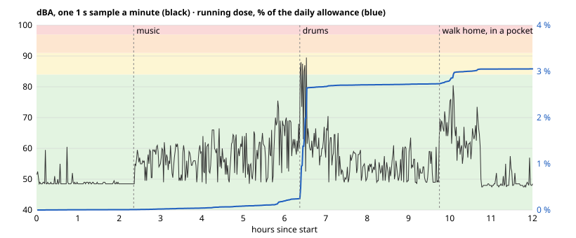

# dbfob

**A dirt-cheap keyfob that tells you how loud it is — and how long your ears can take it.**

Double-click the button, look at the colour. Green means you're fine. Red means leave.

dbfob is an open-hardware sound level indicator sized for a keyring. It exists because nobody pulls out a phone on a dark dance floor to run a sound level meter, but everybody can glance at an LED. It is meant to be cheap enough that a venue, a festival or a hearing-health campaign can hand them out at the door next to the free earplugs.

> **Disclaimer:** dbfob is a hobby project, not a calibrated sound level meter or a medical device. Its readings and dose estimates can be wrong, so don't rely on it to protect your hearing. Use your own judgement: if it feels loud, wear earplugs or step away. If you're worried about your hearing, see a professional.

## Status

**Rev A prototype: boards up and measuring. Calibration at loud levels is not done yet.**

| Part | State |
|---|---|
| [Hardware](hardware/README.md) | 5 assembled boards from JLCPCB, arrived 2026-10-12. Three are running, with no assembly faults so far. Standby measures 8.2 µA ([bring-up log](hardware/README.md#bring-up-log)). |
| [Firmware](firmware/README.md) | Spot check and dosimeter both work: PDM capture, A-weighting, LAeq, dose, and a flash log of the last dosimeter run (40 % CPU, no overruns). At about 61 dBA it reads within 0.5 dB of a consumer meter. The quiet-room floor is about 48 dBA, which doesn't matter for the bands. |
| [Case](hardware/case/README.md) | Two-shell case, in SLA and FDM builds. The FDM build is printed; a fit check with a board is due this week. |

Next steps: confirm a full 12 h dosimeter night, then calibrate at 85–105 dBA against a reference meter. See [Next](#next).

## How it works

1. Double-click the button. The fob wakes from standby. A single press, such as one in a pocket, is ignored.
2. A PDM MEMS microphone samples the room for 3 seconds. Meanwhile the LED bar fills up, so you know the press registered and when the answer is coming.
3. The firmware A-weights the signal and computes the equivalent continuous level (LAeq).
4. A four-LED bar shows two verdicts for 2 seconds: a steady LED for a bare ear and a blinking LED for ear plugs. See below.

The LEDs are deliberately dim, since clubs are dark, and they auto-dim using one LED as a light sensor. The light thresholds are not tuned yet. Each reading is also printed on a UART pad for calibration.

### Colour bands

The bands are **levels at the ear**, not safety guarantees. The times are the full daily allowance at that level under the NIOSH / EU occupational curve, `T = 8 h × 2^((85 − L)/3)`: 85 dBA for 8 hours, 3 dB exchange rate.

| Colour | At the ear (dBA) | Daily allowance at that level |
|---|---|---|
| Green | ≤ 83 | Below the 85 dBA / 8 h limit |
| Yellow | 84–90 | About 10 h down to 2.5 h |
| Orange | 91–96 | About 2 h down to 40 min |
| Red | ≥ 97 | Under about 30 min |

A 3-second spot reading describes the room right now, not your night. The allowance is for a whole day starting from zero, so anything you've already heard today uses part of it. Green means this level is below the limit, not that the whole night is safe.

### Two LEDs, two questions

Every reading answers two questions at once, so there is no mode to set or forget:

- **Steady LED: what reaches a bare ear.** This is the room level itself: measured, with no assumptions.
- **Blinking LED: what would reach the ear through plugs that really give 12 dB.** This is a conditional estimate, not a measurement and not a safety verdict. The fob cannot know how well your plugs fit. Foam plugs claim 30+ dB on the box, but inserted in a hurry by someone who's had a drink, 10–15 dB is realistic. A badly seated plug can give much less. Individual fit testing is the only way to know your own attenuation, and NIOSH recommends it.

In a 100 dBA room, red glows steady and yellow blinks: you're in the red, and well-fitted plugs could bring you to yellow. When both answers are the same, only one steady LED lights.

The obvious alternative was a mode switch, but either default misleads someone. Assume plugs, and people without them get a falsely reassuring answer. Assume no plugs, and people who do wear them always see red, so the device looks useless to the people doing the right thing. Showing both removes the default, and the gap between the two LEDs is itself the argument for plugs.

### Modes

- **Double click — spot check.** Measures the current level and shows a colour for a few seconds. This is the mode that is always trustworthy, because you are holding the device out in front of you.
- **Long press (2 s) — dosimeter.** *Works on the bench. A 9 h run averaged 165 µA at 3.0 V: about 2 mAh per 12 h night, or roughly 80 nights on a CR2032. The first full 12 h runs, ending in auto-off, are in progress.*
  - **Start:** the LEDs light up and flash twice to confirm.
  - **While running:** the fob wakes about every 30 s and samples for 1 s about once a minute, with the LEDs off.
  - **Triple click:** shows the dose so far, bare ear, as a share of the daily allowance. The whole bar blinks for 3 s, and the faster it blinks, the more of the allowance is used: once a second at 0 %, twice a second at 50 %, and steadily lit at 100 %. A single click does nothing, so a press in a pocket doesn't light the fob.

  - **Stop:** another long press. The bar empties from red to green.
  - **Auto-off:** after 12 h it stops by itself. A triple click still shows the final dose until the next start.
  - **Double click:** a spot check, which works as usual while the dosimeter runs.
  - **Log:** the latest run, with about one level per minute, stays in flash after the cell is removed. You can read it later through the programmer with `make dose-log` (see [firmware/README.md](firmware/README.md)).

The catch is that a keyfob lives in a pocket. A pocket reads 10–20 dB low with the high end rolled off, so a dose collected in a pocket is a comforting lie. The dosimeter doesn't yet detect this. It would need to from the spectrum, since the high-band to low-band energy ratio collapses in a pocket, and then refuse to count those samples and flag the dose as incomplete. For now, clip it to your shoulder or a bag strap, with the mic port uncovered.

#### Example night

This is the flash log from one fob over a full 12 h run that ended in auto-off. The fob took 643 samples, all valid. It read with `make dose-log`, and the graph was drawn with `tools/dose_log.py --svg`:



- **Quiet room, 0–2.3 h:** the fob reads its own floor, about 48 dBA.
- **Music, 2.3–6.3 h:** 55–75 dBA. Hours of this barely move the dose.
- **Drums, 6.4 h:** ten minutes at 85–89.5 dBA. That alone takes the dose from about 0.5 % to 2.9 %, because each 3 dB doubles the rate.
- **Walk home, 9.8 h:** up to 80 dBA, with the fob in a pocket. Street noise would have read louder in the open, so this part of the dose is understated: the pocket problem described above.
- **Total:** LAeq 68.1 dBA over 12 h, which is 3.1 % of the daily allowance. A triple click would have shown the slowest blink, about once a second.

A cased and a bare fob side by side through a night in front of a big PA: [docs/logs/2026-10-31-case-ab.md](docs/logs/2026-10-31-case-ab.md).

## Hardware

No radio, no display, no app. The design goal was **under €2 all-in**. The rev A parts come to about $1.85 per board at 1,000 units. A 130 dB-capable mic alone is about €1.2, so sub-€1 is out unless mic prices drop.

| Block | Part | Why |
|---|---|---|
| Microphone | Infineon **IM69D130**, PDM | **Acoustic overload ≥ 130 dB SPL.** Hobby-favourite digital mics clip at about 120 dB, which a club sub stack exceeds. It is digital, with ±1 dB sensitivity, so a batch can be calibrated rather than each unit, and the reading doesn't drift with battery voltage. |
| MCU | WCH **CH32V003F4P6** | The CH32V002/V006 are pin-compatible drop-ins, but were out of stock. The V003 has no hardware multiplier (handled in firmware) and needs at least 2.7 V. |
| LEDs | 4 × 0603 low-Vf LEDs as a bar: yellow-green, yellow, orange, red | InGaN green and blue LEDs need about 3 V and fade on a coin cell. The bar position also encodes the level for colour-blind users. D4 doubles as the light sensor. |
| Power | CR2032 in a Keystone 3034 | Standby measures 8.2 µA, so an idle fob lasts about 3 years. The mic is powered only while measuring. The dosimeter averages about 165 µA. |
| Input | 1 × tactile switch | Wakes the MCU. |
| Case | 3D-printed two-part shell, one M2 screw | Mic and LEDs at one end, keyring at the other. |

Background and trade-offs:
- The part comparison is in [docs/mic-mcu-options.md](docs/mic-mcu-options.md).
- An independent hardware audit, with the response to each finding, is in [docs/hardware-audit-2026-09-27.md](docs/hardware-audit-2026-09-27.md).

### Accuracy

Cheap MEMS parts are ±3 dB sensitivity; better ones are ±1 dB and factory-calibrated. Either is fine for four colour bands. The real uncertainty in this device is placement (held out vs. cupped in a hand vs. in a pocket) and earplug fit, not the microphone. Design effort goes into making "not trustworthy" visible, not into the last dB.

### Calibration

A 94 dB pistonphone won't couple to a MEMS port. Calibrate by substitution instead: place the fob next to a measurement mic in a room with pink noise at a few levels, note the offset, store it in flash. Also characterise the offset when hand-held vs. on a table, since that is how people will actually use it.

## Repository layout

```
hardware/        KiCad project, generated from the tables in hardware/tools/ (schematic, PCB, JLC outputs)
hardware/case/   FreeCAD case script, STEP/STL for printing, board geometry it is built from
firmware/        CH32V003 firmware on ch32fun: PDM capture, A-weighting, LAeq, LEDs, standby, dosimeter and its
                 flash log (tools/dose_log.py decodes it); host tests
docs/            part selection, hardware audit, log readout ideas
```

## Next

- [x] First bring-up: power, programming, mic capture, CPU load.
- [x] Standby current (8.2 µA) and the dosimeter current profile.
- [ ] VDD reference trim, light-sense thresholds. See [firmware/README.md](firmware/README.md#bring-up-checklist).
- [ ] Calibrate against a reference meter at 85–105 dBA, in the case: the level offset and the hand-held offset. So far it has only been compared with a consumer meter at about 61 dBA.
- [ ] Qualify the battery: the supply voltage under load across cell charge and temperature, then set the cutoff. At 2.8 V the sample wakes read 25 % more current than at 3.0 V. Re-measure on a range with a smaller burden voltage. A low-battery lockout (2.75 V) now keeps a tired cell from hanging the V003; test it with real cells. Wakes peak at over 10 mA with the LEDs on, which is hard on a CR2032.
- [x] Print the case.
- [ ] Check the printed case: the tolerances, the button flexure and the mic seal.
- [ ] A calibration procedure anyone can repeat with a known-good meter.
- [ ] Rev B board ([directions, checked facts, experiments](docs/rev-b.md)): centre the mic port, add UART RX for a bootloader, CH32V002/V006 if in stock, possibly a power latch for shelf life, a way to read the dose log without a programmer ([ideas](docs/log-readout.md)). Full-band A-weighting to 20 kHz: rev A stops at 11.7 kHz, which reads only ~0.2–0.9 dB low on broadband noise, but high-frequency content is exactly what a listener stops noticing after a few drinks at a club. Needs ~47 kHz samples, so an MCU with PDM hardware or the headroom for the 3 MHz mic clock without a battery penalty ([band limit](firmware/README.md#signal-chain)).
- [ ] Dosimeter: confirm the 12 h auto-off and the flash log over a full night, then occlusion (pocket) detection.
- [ ] Get a batch into a venue and see if people use them.

## Non-goals

- Bluetooth, apps, logging to the cloud. The point is that nothing needs to be looked at except one LED.
- Certified measurement accuracy. This is a warning light, not a Class 1 meter.

## Why

Hearing damage is cumulative and irreversible, and the people most at risk are the ones who go out the most. Earplugs are cheap and effective, but people don't put them in unless they have a reason to. A colour that says "you are in the red" is a reason.

## License

Hardware: CERN-OHL-P. Firmware: MIT. Documentation: CC BY 4.0.
