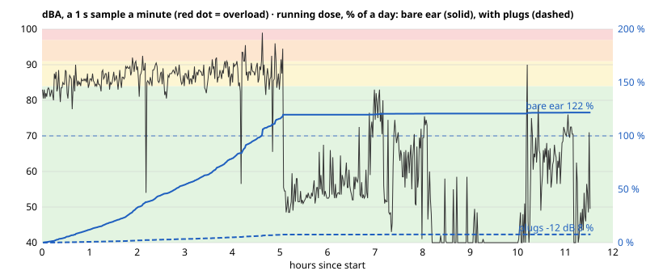
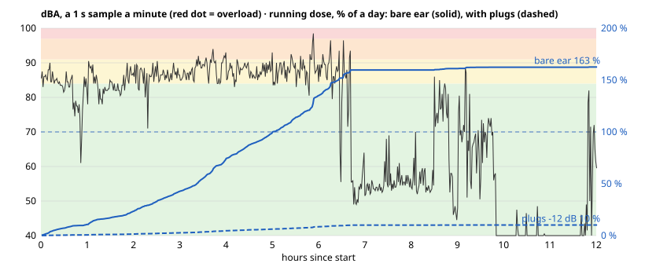

# Cased vs bare, one night in front of a big PA (2026-10-30/31)

Two fobs ran side by side through one night in front of a big sound system: one in the printed case (`koteloitu`), one bare board (`koteloimaton`). Both flash logs were read on 2026-10-31 with `make dose-log`.

| | cased | bare |
|---|---|---|
| log | [2026-10-31-cased.bin](2026-10-31-cased.bin) | [2026-10-31-bare.bin](2026-10-31-bare.bin) |
| samples | 646, all valid, 0 overloaded | 648, all valid, 0 overloaded |
| sample period | 64.2 s | 66.8 s |
| run | 11.53 h, still running when the cell was pulled | 12.02 h, auto-off |
| LAeq / dose (bare ear) | 84.3 dBA / 121.9 % | 85.3 dBA / 162.7 % |
| LAeq / dose (with plugs) | 72.3 dBA / 7.7 % | 73.3 dBA / 10.3 % |
| min / max | 35.0 / 99.0 dBA | 35.0 / 98.5 dBA |

The whole-run numbers are not comparable directly: the bare fob started 1.66 h earlier, so it caught 1.7 h more of the loud part.

## Alignment

The bare fob started 5970 s (1.66 h) before the cased one. The offset was found by minimising the RMS difference of 10-minute LAeq windows, and it matches the obvious events by eye: the music stops at 5:05 cased / 6:45 bare, the room goes quiet at 8:10 / 9:50, and the walk out starts at 10:07 / 11:41. That last one is 6 min short of the others, about 1 % timing drift between the two fobs' tick calibrations over 10 h.

## Overlap

Over the span both fobs logged:

- **LAeq:** 84.7 dBA cased, 85.5 dBA bare.
- **Loud part (33 ten-minute windows at 80+ dBA):** cased reads 1.2 dB lower on average, median 0.9 dB lower. Single samples spread about 3 dB (1 s spot samples of music), so the error of the mean is about 0.25 dB: the ~1 dB gap is real, not sampling noise.
- **Mid and quiet parts:** windows differ by up to ±14 dB. These are local sounds near one fob (talk, handling), not a gain difference.
- **Floor:** both bottom out at exactly 35.0 dBA.
- **Peaks:** 99.0 / 98.5 dBA, no overloads on either; 3 and 4 samples at 95+ dBA.

## What it does and doesn't say

The cased fob reads about 1 dB lower in loud music. That's small: it moves the dose by about 25 %, and it's inside the IM69D130's ±1 dB sensitivity tolerance. But this run mixes three things: the case, the unit-to-unit gain and where each fob sat. To pull out the case alone:

1. Swap the case to the other board and repeat, or
2. put both bare boards side by side on steady pink noise next to the AC2, then case one of them.

Both fobs agree on the floor (35.0 dBA) and neither overloaded near a big PA at up to 99 dBA in 1 s samples, so the 2^18 scale had headroom here.
