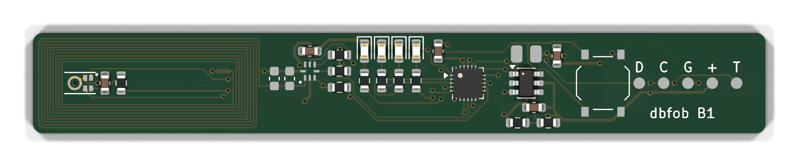

# B1 (rev B)

A stick, 10.5 × 76.5 × 1.0 mm, 4 layers, with the mic at the tip and one AAA cell on the back: rev A's metering, with the log readable by tapping a phone. Scope and part choices are in [docs/rev-b.md](../../docs/rev-b.md#b1-stick-aaa-instead-of-cr2032-decided-2026-11-09).



**Status: redrawn as the AAA stick on 2026-11-09, not ordered.** The first draft (2026-11-03) was a 30 × 26 mm CR2032 board. B1 goes in the same order as the [NFC test board](../nfc-test/README.md), which carries the identical antenna, outline and cell. The trim value found on the test board goes onto B1's C1/C2.

## What's on it

Along the stick from the tip:

- **The tip, 24 mm:** the NFC coil, from [../lib/antenna.py](../lib/antenna.py), shared with the test board. It has 9 turns of 0.15 mm track with a 0.15 mm gap, about 2.25 µH in air (NXP AN11276). The mic MK1 sits inside it, with its port through the board, and C6/R8 sit beside it. The coil's inner end meets LB at net tie NT1; LB crosses under the turns on B.Cu.
- **Just past the coil:** the tag U1, trim pads C1/C2 and C3.
- **The middle:** the tag's pull-ups, then the LED bar (LED at the top edge, its resistor below), then the MCU U2.
- **The far end:** the boost converter U3 with L1 over it and C5 under it, so the switching and output loops stay on F.Cu (hand-drawn), then the button, then the programming pads.
- **Back:** the AAA cell between two MYOUNG MY-AAA-07 spring contacts, hand-fitted, + towards the far end. Everything past the coil sits under the cell.
- **No planes or pours on any layer.** Copper near the loop detunes it, so GND is tracks. Every layer under the coil is kept clear, apart from a band at its cell end where LB and the mic's nets cross under the turns.

**Why 4 layers:** two would not route in 10.5 mm. The MCU's fan-out, the tag's lines and the mic's lines share one corridor, and the contacts' pads fill the middle of B.Cu. The inner layers carry signals only.

| Ref | What | Note |
|---|---|---|
| U2 | CH32L103F8U6, C22467836 | QFN-20 3 × 3. No NRST pin, BOOT0 tied low inside |
| U3 | TLV61220DBVR, C111811 | boost, 0.7 V start-up, 3.0 V out (R9 1 MΩ / R10 200 kΩ); EN to the cell, always on |
| L1 | MPL2016S4R7MHT, C98335 | 4.7 µH, 2.0 × 1.6 mm, multilayer |
| C5, C7 | 10 µF | boost output, input |
| MK1 | IM66D130M, C52053030 | **20 at JLC on 2026-11-09** (0 on 2026-11-03): order early. 0.5 mm port (NPTH) through the board, inside the coil |
| R8, C6 | 100 Ω, 1 µF (C15849) | mic supply from PA4, filtered against the boost's burst ripple |
| U1 | NT3H2111W0FHKH, C710403 | NTAG I2C plus 1k, powered from PB14 |
| C1, C2 | 0603 trim, **not fitted** | C0G, value from the NFC test board |
| C3, C4 | 100 nF | tag and MCU decoupling |
| R1, R2 | 4.7 kΩ | SDA / SCL pull-ups to NFC_VCC |
| R3 | 100 kΩ | FD pull-up to VDD |
| D1–D4, R4–R7 | as rev A | each on its own hardware PWM channel; D4's cathode on PA10 for ambient-light sensing |
| SW1 | TS-1187A, C318884 | measure button, PA0/WKUP to VDD: no resistor |
| BT1 | 2 × MY-AAA-07 (C6937109) | **hand-fit on the back**, so JLC assembly stays one-sided |
| J1 | five 1.2 mm pads, 2.54 mm | `D C G + T` = SWDIO, SWCLK, GND, VDD, TX: WCH-LinkE pogo clip + the dB stream |

**MCU pins** (full table in `tools/gen_sch.py`):

| Pin | Net | | Pin | Net |
|---|---|---|---|---|
| 1 PA0 | BTN (WKUP: wakes Standby on a rising edge) | | 7 PA7 | VCELL (ADC7: the cell, for the low-battery lockout) |
| 2 PA1 | LED_O (TIM2_CH2) | | 8 PB0 | FD (EXTI) |
| 3 PA2 | LED_Y (TIM2_CH3) | | 9 PB10 | SCL (I2C2) |
| 4 PA3 | LED_G (TIM2_CH4) | | 10 PB11 | SDA (I2C2) |
| 14 PA8 | LED_R (TIM1_CH1) | | 12 PB14 | NFC_VCC |
| 18 PA10 | LED_R_K | | 15 PA9 | TX (USART1) |
| 5 PA4 | MIC_PWR (through R8 to MIC_VDD) | | 17 PA13 | SWDIO |
| 6 PA5 | MIC_CLK (SPI1 SCK) | | 16 PA14 | SWCLK |
| 20 PA6 | MIC_DATA (SPI1 MISO) | | 11, 13 | spare (PB13, PB15) |

- **Button on WKUP.** With EWUP set, PA0 is forced to an input with pull-down in Standby, so the button goes to VDD and needs no resistor. Not PB13: it shares a pad with PB6 = CC1, and some lots force CC1's 5.1 kΩ pull-down on in Standby (datasheet table 3-8-1 note 3). For the same reason NFC_VCC is on PB14, not PB13.
- Pins sharing a pad inside the chip (PB1/PB10, PA10/PB7, PA11/PA13, PA12/PA14): only one of each pair may drive. Keep CC2_PD off, or PA10 gets 5.1 kΩ to ground.
- **Power.** The boost runs all the time, and the MCU's Standby sets the floor: about 0.5 µA into the converter, 5 µA at its output and 2.5 µA in the divider. VCELL (0.9–1.8 V) is always under VDD, so PA7 reads it directly. It is the boost's input node, with the inductor's ripple on it and no RC filter: average many ADC samples, or take them while the converter idles.
- **Programming.** A WCH-LinkE on J1 feeds 3.3 V into VDD past the converter, which doesn't feed back into the cell. The cell can stay in.
- **Firmware notes:** PA4 is also SPI1_NSS (use SSM=1, SSOE=0). Set PB2 (no pin on this package) as a pull-down input in low power. Turn I2C2 off and set SDA/SCL to analog before dropping NFC_VCC. Likewise set MIC_CLK/MIC_DATA (PA5/PA6) low or analog before PA4 drops MIC_PWR: a high clock would feed the mic's supply through its ESD diode and sink about 20 mA through R8 into PA4. PA0 (BTN) has no series resistor: never drive it as an output, or a press shorts VDD into it.

**Not yet shown on the bench:**
- Waking Standby by an EXTI event on FD (PB0). The reference manual says any EXTI event wakes Standby, but no example does it. If it doesn't work, FD wakes from Stop (about 4.5 µA) instead.
- R3 (100 kΩ) against the tag's FD leakage (10 µA max). Measure FD current with VCC off on the test board; keep 100 kΩ only if it is well under 1 µA.
- The boost's ripple at the mic, and the converter's real standby draw from an AAA.

## Regenerate

```sh
python3 hardware/lib/gen_lib.py          # symbols, IM66D130M, AAA contact + pad footprints
python3 hardware/b1/tools/gen_sch.py     # tables -> schematic
python3 hardware/b1/tools/make_pcb.py    # antenna + placement + hand vias, the router does the rest
python3 hardware/b1/tools/fab.py         # -> production/
```

Same procedure as rev A ([../README.md](../README.md)). Routing is signals first, then GND, VDD and VCELL, with the router's inside_out ordering and `--via-proximity-cost 0`. At the default (tenfold via cost near pads), the MCU's bottom pins never drop to the inner layers. Drawn by hand before routing: the boost's SW, GND and VDD loops, U2's decoupling feed (pin 19 to C4), and VCELL to U2's ADC pin (through In2, which the router couldn't reach). The router reshapes SW even though it isn't routing that net, so a User.2 polygon (KiCadRoutingTools `--keepout`) keeps other nets out of SW's gap, and `restore_sw()` puts the straight track back after routing. The router's result swings with small changes: rerun after any placement edit and check that it is still clean.

**State at commit:**
- **ERC:** clean, apart from the library-table warnings and two whitelisted pin-to-pin notes: NFC_VCC, a GPIO-driven supply as on rev A, and PA7 reading the power-flagged VCELL.
- **DRC:** 0 errors, 0 unconnected, 0 parity issues.
- **Repeatability:** two runs give byte-identical boards.
- **CPL:** 24 of 25 placements checked against JLC's EasyEDA footprints. U3 (SOT-23-6) needs a 180° correction, which fab.py applies. MK1 has no EasyEDA footprint: check its rotation in JLC's DFM preview.

## Before ordering

- Stock on 2026-11-09: CH32L103F8U6 481, TLV61220 10 670, IM66D130M 20, MY-AAA-07 3 594. Recheck the MCU and the mic on order day.
- **ENIG finish:** the mic's pads are NSMD (0.05 mm mask clearance on them).
- **Check JLC's DFM preview** for the mic: its rotation, and that the copper ring round the 0.5 mm port isn't trimmed (JLC may remove thin copper rings at NPTHs).
- 4 layers at 1.0 mm: check JLC's stack-up price against the test board's, since both use it.
- U2's GND via sits in the exposed pad, between the paste windows: expect a little solder wicking.
- No keyring hole in the PCB: the case carries it.
- No reverse-cell protection: a reversed AAA puts −1.5 V on the TLV61220 (abs. min −0.3 V). The case must key the cell's direction.
- Fit C1/C2 with the value found on the test board.
