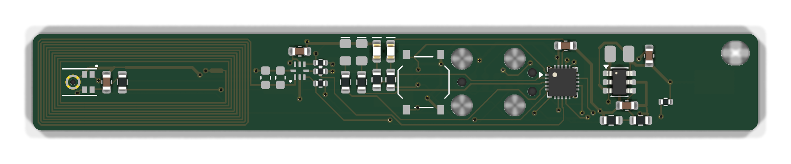

# B1 (rev B)

A stick, 10.5 × 78.5 × 1.6 mm, 4 layers, with the mic at the tip and one AAA cell on the back: rev A's metering, with the log readable by tapping a phone. Scope and part choices are in [docs/rev-b.md](../../docs/rev-b.md#b1-stick-aaa-instead-of-cr2032-decided-2026-11-09).



**Status: boards arrived, bring-up started 2026-11-26** (see [Bring-up](#bring-up)). Ordered from JLCPCB on 2026-11-16 (commit e3a0548: 5 boards, 4 layers, 1.6 mm, ENIG, Economic PCBA on the top side, mic SPH0655LM4H-1). Redrawn as the AAA stick on 2026-11-09. The first draft (2026-11-03) was a 30 × 26 mm CR2032 board. The [NFC test board](../nfc-test/README.md) shares its antenna, outline and cell but was dropped from the order on 2026-11-12: B1 finds its own trim (see [On the bench](#on-the-bench-nfc)).

## What's on it

Along the stick from the tip:

- **The tip, 24 mm:** the NFC coil, from [../lib/antenna.py](../lib/antenna.py), shared with the (unordered) test board. It has 9 turns of 0.15 mm track with a 0.15 mm gap, about 2.25 µH in air (NXP AN11276). The mic MK1 sits inside it, with its port through the board, and C6/R8 sit beside it. The coil's inner end meets LB at net tie NT1; LB crosses under the turns on B.Cu.
- **Just past the coil:** the tag U1, trim pads C1/C2 and C3.
- **The middle:** the tag's pull-ups, the LED bar (LED at the top edge, its resistor below, with only the cathode bar in silk; D1 and D2 are 0805, D3 and D4 0603, all four columns on one 1.75 mm pitch, LEDs in one row and resistors in another; the pull-ups and C3 stand 1.05 mm from the tag's body, JLC's spacing for a QFN), then the button SW1 about mid-stick (x 42.3 of 78.5), where a thumb finds it while the far end rests in the hand. Then the Tag-Connect footprint J1, **pads on the back**, under the cell, so a sweaty thumb can't touch them; its guide and clip holes go through the board in the gap between the two contacts' base pads. Then the MCU U2, still in that gap, so its vias have room all round, and right after it the boost converter U3, with L1 over it and C5 under it, so the switching and output loops stay on F.Cu (hand-drawn). It sits over the + contact's base pad: its VCELL via goes into that pad, the rest of its vias above and below it.
- **The far end:** a 2.4 mm round ring hole H1 in the corner, past the + contact's plate, for hanging the stick up. The MY-AAA-07 drawing has no dimension for the plate; scaled from it, the plate's top lip stands 1.4 mm inboard of the foot's tip, which puts it at x 74.2 to 74.5 depending on where the contact sits on its pads, with about 0.4 mm of scaling and part tolerance on top. The hole starts at x 75.2 and is as big as the corner allows: 0.9 mm of web to the end and to the side, 0.72 mm to the contact's foot pad (a hole counts as board edge). The board is 2 mm longer than the first B1 draft to make room. Solder the + contact towards the mic end of its pads, and check the gap with a real one. The board's name is on the back silk, under the coil.
- **Back:** the AAA cell between two MYOUNG MY-AAA-07 spring contacts, hand-fitted, + towards the far end. Other nets' vias keep at least 0.35 mm from the contacts' pads (the pads are grown while routing), so hand-soldering has room. Everything past the coil sits under the cell.
- **No planes or pours on any layer.** Copper near the loop detunes it, so GND is tracks. Every layer under the coil is kept clear, apart from a band at its cell end where LB and the mic's nets cross under the turns.

**Why 4 layers:** two would not route in 10.5 mm. The MCU's fan-out, the tag's lines and the mic's lines share one corridor, and the contacts' pads fill the middle of B.Cu. The inner layers carry signals only.

| Ref | What | Note |
|---|---|---|
| U2 | CH32L103F8U6, C22467836 | QFN-20 3 × 3. No NRST pin, BOOT0 tied low inside |
| U3 | TLV61220DBVR, C111811 | boost, 0.7 V start-up, 3.0 V out (R9 1 MΩ / R10 200 kΩ); EN to the cell, always on |
| L1 | MPL2016S4R7MHT, C98335 | 4.7 µH, 2.0 × 1.6 mm, multilayer |
| C5, C7 | 10 µF | boost output, input |
| MK1 | Knowles SPH0655LM4H-1, C22376158 | 132.5 dB SPL AOP, −37 ±1 dBFS, normal mode 1.1–4.8 MHz (below 0.9 MHz it drops to low-power mode, 116 dB AOP: keep the clock at 1.5 MHz). 0.6 mm port (NPTH) through the board, inside the coil. Replaces the IM66D130M, which JLC assembles only as Standard PCBA |
| R8, C6 | 100 Ω, 1 µF (C15849) | mic supply from PA4, filtered against the boost's burst ripple |
| U1 | NT3H2111W0FHKH, C710403 | NTAG I2C plus 1k, powered from PB14 |
| C1, C2 | 0603 trim, **not fitted** | C0G, value found on the bench: 22 pF in C1 on board 1 (see Bring-up) |
| C3, C4 | 100 nF | tag and MCU decoupling |
| R1, R2 | 4.7 kΩ, 0402 (C25900) | SDA / SCL pull-ups to NFC_VCC. 0402 to make room for the 0805 LEDs |
| R3 | 100 kΩ, 0402 (C25741) | FD pull-up to VDD |
| R11 | 4.7 kΩ, 0402 (C25900) | in series with PA7's cell sense |
| D1–D4, R4–R7 | green KT-0805G (C2297), yellow KT-0805Y (C2296), red KT-0603R (C2286) ×2; 1 kΩ, 2.2 kΩ ×3 | **All JLC basic parts** (no extended fee), which is why the bar is green, yellow, red, red: basic has no orange, and green and yellow only in 0805. The green is InGaN (2.6–3.1 V at 5 mA) on the 3.0 V rail: dim by design, tune R4 on the bench. Each on its own hardware PWM channel; D4's cathode on PA10 for ambient-light sensing. D3's net is still called LED_O |
| SW1 | TS-1187A, C318884 | measure button, PA0/WKUP to VDD: no resistor |
| BT1 | 2 × MY-AAA-07 (C6937109) | **hand-fit on the back**, so JLC assembly stays one-sided |
| H1 | 2.4 mm NPTH | ring / cord hole in the far corner; a light split ring is fine, but a heavy key bunch should hang from the case |
| J1 | Tag-Connect TC2050-IDC footprint (KiCad stock `TC2050-IDC-FP`, for the legged plug), no part | 2 × 5 pogo pads at 1.27 mm, 3 guide holes and 4 clip holes (2.4 mm), **on the back**, along the stick between the button and the MCU, its holes in the gap between the contacts' base pads, 0.4 mm clear of the button's body on the front, where the clips latch. ARM Cortex 10-pin pinout: 1 VDD (VTref), 2 SWDIO, 4 SWCLK, 6 TX (SWO slot: the dB stream), 3/5/9 GND; 7, 8, 10 not connected (no NRST pin) |

**MCU pins** (full table in `tools/gen_sch.py`):

| Pin | Net | | Pin | Net |
|---|---|---|---|---|
| 1 PA0 | BTN (WKUP: wakes Standby on a rising edge) | | 7 PA7 | VCELL (ADC7: the cell, for the low-battery lockout) |
| 2 PA1 | LED_O (TIM2_CH2) | | 8 PB0 | FD (EXTI) |
| 3 PA2 | LED_Y (TIM2_CH3) | | 9 PB10 | SCL (I2C2) |
| 4 PA3 | LED_G (TIM2_CH4) | | 10 PB11 | SDA (I2C2) |
| 14 PA8 | LED_R (TIM1_CH1) | | 12 PB14 | NFC_VCC |
| 18 PA10 | LED_R_K | | 15 PA9 | TX (USART1) |
| 5 PA4 | MIC_PWR (through R8 to MIC_VDD) | | 17 PA13 | SWDIO |
| 6 PA5 | MIC_CLK (SPI1 SCK) | | 16 PA14 | SWCLK |
| 20 PA6 | MIC_DATA (SPI1 MISO) | | 11, 13 | spare (PB13, PB15) |

- **Button on WKUP.** With EWUP set, PA0 is forced to an input with pull-down in Standby, so the button goes to VDD and needs no resistor. Not PB13: it shares a pad with PB6 = CC1, and some lots force CC1's 5.1 kΩ pull-down on in Standby (datasheet table 3-8-1 note 3). For the same reason NFC_VCC is on PB14, not PB13.
- Pins sharing a pad inside the chip (PB1/PB10, PA10/PB7, PA11/PA13, PA12/PA14): only one of each pair may drive. Keep CC2_PD off, or PA10 gets 5.1 kΩ to ground.
- **Power.** The boost runs all the time, and the MCU's Standby sets the floor: about 0.5 µA into the converter, 5 µA at its output and 2.5 µA in the divider. PA7 reads VCELL (0.9–1.8 V) through R11 (4.7 kΩ): PA7 is not 5 V tolerant, and while the boost starts VDD is a diode drop under VCELL, so the resistor limits the current into the pin's clamp. Give the ADC a long sample time for the source resistance. VCELL is the boost's input node, with the inductor's ripple on it and no RC filter: average many ADC samples, or take them while the converter idles.
- **Programming and calibration.** A legged TC2050-IDC cable on J1 from the back (with **the cell out**): its clips latch through the board and hook on the front, beside the button. The probe powers the board through pin 1. A probe that drives pin 1 (VTref) at 3.3 V powers VDD past the converter, which doesn't feed back into the cell. A sense-only probe (J-Link, ST-Link) just reads the boost's 3.0 V. 
- **Firmware notes:** PA4 is also SPI1_NSS (use SSM=1, SSOE=0). Set PB2 (no pin on this package) as a pull-down input in low power. Turn I2C2 off and set SDA/SCL to analog before dropping NFC_VCC. Likewise set MIC_CLK/MIC_DATA (PA5/PA6) low or analog before PA4 drops MIC_PWR: a high clock would feed the mic's supply through its ESD diode and sink about 20 mA through R8 into PA4. PA0 (BTN) has no series resistor: never drive it as an output, or a press shorts VDD into it.

**Not yet shown on the bench:**
- Waking Standby by an EXTI event on FD (PB0). The reference manual says any EXTI event wakes Standby, but no example does it. If it doesn't work, FD wakes from Stop (about 4.5 µA) instead.
- R3 (100 kΩ) against the tag's FD leakage (10 µA max). Measure FD current with NFC_VCC off (PB0 as an analog input, meter in series with R3 or across it); keep 100 kΩ only if it is well under 1 µA.
- The boost's ripple at the mic, and the converter's real standby draw from an AAA.

## Bring-up

**2026-11-26, board 1**, powered at 3.3 V from the programmer through J1, no cell, test firmware [`firmware/b1-test`](../../firmware/b1-test) (882792f):
- The CH32L103 answers on the 2-wire debug interface and identifies as CH32L103, 64 kB, read protection off. It flashed first time.
- Programmer: the ESP32-S2 from rev A (esp32s2-funprog 5.30) with minichlink; it finds 2-wire chips by itself. Wiring is in [firmware/README.md](../../firmware/README.md#flash).
- All four LEDs light in the sweep. The green one is by far the brightest at 3.3 V, the opposite of what the table above expects: R4 needs to go up, not down. Check again on the cell's 3.0 V rail before picking a value.
- The button reads on PA0 (pull-down, no bounce trouble at a 200 ms poll), and printf over the two debug wires works through the ESP32-S2 (`make monitor`).
- The yellow LED (590 nm) looks orange next to the green.
- Boost converter from a bench supply on the contact pads, first test firmware running (MCU awake at 96 MHz, one LED lit): 16.3 mA at 1.5 V. VDD is 3.024 V at 1.5 V in, 3.047 V at 1.0 V, 3.036 V at 0.8 V, and still 3.024 V at 0.57 V. So the rail holds well past the end of an alkaline cell (0.9 V); the firmware's low-battery lockout decides the real end. With a DMM in series for current the board died at 0.66–0.67 V instead (48 mA there): that was the meter's burden voltage, not the converter, and not the supply's current limit.
- NFC tag from the MCU: powered from PB14, both pull-ups work, it answers at I2C address 0x55 and gives a valid NXP serial number (04 70 36 aa 62 26 90). Its capability bytes are 00: blank, no NDEF format yet.
- Mic: powered from PA4 and clocked at 2 MHz from SPI1, its bit stream is half ones. Per 512 bits the count stays within 258–261 in a quiet room and swings between 53 and 397 when blown on: it hears.
- ADC: **do not run the ADC's calibration (RSTCAL/CAL) as on other CH32 parts.** With it, every reading came out 2048 counts too high, or zero. Without it, Vrefint reads 1497 at 3.3 V (1.2 V × 4095 / 1497 = 3.28 V) and the calibration channel 18 reads 2057, 9 counts over half scale; the test firmware takes that off as the offset. The proper sequence for this chip is still to be read from WCH's library.
- Cell reading on PA7 (through R11, 16 conversions averaged, 239.5-cycle sample time, Vrefint taken as 1.200 V), board on a bench supply with only the debug wires attached: 1500–1504 mV at 1.5064 V on the DMM, 998–1003 mV at 1.0081 V. That is 0.4–0.8 % low with ±2 mV of noise, uncalibrated: good enough for the low-battery lockout as it is. VDD reads 3022–3026 mV against the DMM's 3.024 V.
- The converter also starts from 0 at 0.57 V (datasheet: 0.7 V typical).
- Tag formatted from the MCU (`firmware/b1-test` 6d93e22): capability bytes E1 10 6D 00 and an NDEF URL in blocks 1–2, read back correctly.
- Coil: 2.25 Ω across C1's pads, so it is whole and joined to the tag.
- Phone tap, antenna untrimmed (C1/C2 empty): one phone reacted once before the tag was formatted, and none since, formatted or not. The trim is the open point (see below).
- **Untrimmed resonance: 16.83 MHz**, Q about 32 (LibreVNA, one-turn loop of about 205 nH on port 1, 5–35 MHz, −20 dBm, board unpowered, no cell; three sweeps agree). Seen as a 4.2 Ω bump in the loop's resistance, 1.4 dB in S11. That is 3.3 MHz above the carrier with a half-width of 0.26 MHz, which explains the phones. With the tag's 50 pF this makes the coil about 1.8 µH, and the trim formula below gives 27 pF for 13.56 MHz and 22 pF for 14.0 MHz.
- **C1 = 22 pF fitted: 13.90 MHz**, Q still about 32 (same set-up, no cell, no phone). The shift says the tag and strays were 47 pF, so the formula holds on this board.
- **Standby current** ([`firmware/b1-standby`](../../firmware/b1-standby) be1a019, nothing attached, DP832A on the contact pads, 34461A in series, 2 s averages): 17.2 µA at 1.7 V, 19.4 µA at 1.5 V, 22.9 µA at 1.3 V, 27.7 µA at 1.1 V, 35.0 µA at 0.9 V. That is a constant 29–31 µW, about 8 µA on the 3.0 V rail, as estimated above (converter, divider, MCU). Awake at 16 MHz with one LED blinking it draws 7.2–8.7 mA at 1.5 V.
- **Getting into Standby took three tries.** With the entry sequence from ch32fun's `examples_l103/standby` the board sat at 1.75 mA (0.75 mA on the 3.0 V rail, constant power over 0.9–1.7 V in) and did not wake on the button. It works with WCH's own sequence (`EVT/EXAM/PWR/Standby_Mode`): switch off the USB-PD pins' 5.1 kΩ pull-downs, which are on after reset (`USBPD->PORT_CC1/2 &= ~CC_PD`), then write PWR_CTLR once with flash low-power mode 1, CWUF and PDDS. Which of the two changes did it is not yet isolated.
- **Measure Standby on the DMM's 10 mA range, not the 100 µA range.** On the 34461A's 100 µA range the reading was overload for 10 s on end: either the range change restarts the board and it then cannot get through its awake phase across that range's shunt, or the converter's refill bursts exceed the range. Back on the 10 mA range it read 17.6 µA again at once.
- The button wakes it out of Standby (PA0/WKUP, no resistor): the firmware sees the wake-up and standby flags, runs its 8 s and goes back to sleep.
- Not yet checked: VDD's ripple, the antenna trim and read distance, the cell contacts.

## On the bench: NFC

Experiment 4 runs here (the test board was dropped). The tag runs from the phone's field, so it needs no firmware for steps 1–3.

1. **No cell, C1/C2 empty.** Tap with an Android (NXP TagInfo) and an iPhone; write a URL with NFC Tools. Note the read distance.
2. **Find the resonance.** With a NanoVNA and a small pickup loop, read the S11 dip f0; trim **C = 50 pF × ((f0 / 13.56 MHz)² − 1)** in C1 (C0G). Without a VNA, try 0, 4.7, 10, 15 and 22 pF and keep the longest read distance.
3. **Fit the cell** (alkaline and lithium AAA) and repeat 1–2: the cell's effect. The value from here (or in the case) goes on every board.
4. **Locked iPhone:** with the screen on, a tap should open the URL with no app.

## Regenerate

```sh
python3 hardware/lib/gen_lib.py          # symbols, mic, AAA contact + pad footprints
python3 hardware/b1/tools/gen_sch.py     # tables -> schematic
python3 hardware/b1/tools/make_pcb.py    # antenna + placement + hand vias, the router does the rest
python3 hardware/b1/tools/fab.py         # -> production/
```

Same procedure as rev A ([../README.md](../README.md)). Routing is signals first, then GND, VDD and VCELL, with the router's mps ordering, backward direction and `--via-proximity-cost 0`. At the default (tenfold via cost near pads), the MCU's bottom pins never drop to the inner layers. Drawn by hand before routing: the boost's SW, GND and VDD loops, U2's decoupling feed (pin 19 up to C4), VCELL to U2's ADC pin (through In2 along the bottom edge, which the router couldn't reach), and LED_R and NFC_VCC out of U2's right column over the + contact's base pad to vias below it. SW is drawn whole and kept from the router, which reshapes it anyway; `restore_hand()` puts it back after routing. FD (U2's bottom-row pin 8 along the bottom edge to the tag) is drawn first as a guide and left to the router to reshape. The tag's pull-ups get escape vias by hand (VDD, NFC_VCC, SDA), and a User.2 polygon (KiCadRoutingTools `--keepout`) keeps other nets out of SW's gap. Also by hand: a GND via for C3, boxed in behind the tag's top row, and on the back, a VDD stub from J1 pin 1 out between two clip holes and a GND link between J1's diagonal neighbours 3 and 9. The router doesn't know the 0.25 mm copper-to-hole clearance, so J1's and H1's NPTH pads are grown 0.2 mm while it routes (`restore_npth()`). The router's result swings with small changes: rerun after any placement edit and check that it is still clean.

**State at commit:**
- **ERC:** clean, apart from the library-table warnings and one whitelisted pin-to-pin note: NFC_VCC, a GPIO-driven supply as on rev A.
- **DRC:** 0 unconnected, 0 parity issues, and 0 errors after `fab.py`'s whitelist. Raw KiCad DRC reports 10, all deliberate overlaps with BT1's courtyard under the cell: J1's holes, courtyard and keepout (9) and H1 (1).
- **Repeatability:** two runs give byte-identical boards.
- **CPL:** all 25 placements checked against JLC's EasyEDA footprints, MK1's port hole included. U3 (SOT-23-6) needs a 180° correction, which fab.py applies.

## Before ordering

- Stock on 2026-11-15: CH32L103F8U6 5 294, TLV61220 10 950, SPH0655LM4H-1 3 630, NT3H2111 46 922, MY-AAA-07 3 555. Recheck the MCU on order day (it was down to 119 on 11-10).
- **Economic PCBA:** every placed part is Economic-eligible on 2026-11-15. The board is 10.5 mm wide against Economic's 10 mm minimum. The MY-AAA-07 contacts are not placed: order 2 per board from LCSC.
- Extended parts (JLC setup fee each): L1, MK1, U1, U2, U3. The rest are Basic.
- **ENIG finish:** flat pads for the mic's seal ring and the QFNs, and J1's pads are bare contacts for pogo pins.
- **Check JLC's DFM preview** for the mic: its rotation, and that the copper ring round the 0.6 mm port isn't trimmed (JLC may remove thin copper rings at NPTHs).
- 4 layers at 1.6 mm. Drawn for 1.0 mm, but JLC's order form would not take 1.0 mm for this order (2026-11-16); nothing in the layout depends on it. The mic's port is 0.6 mm longer for it.
- U2's GND via sits in the exposed pad, between the paste windows: expect a little solder wicking.
- Only a small ring hole (H1) in the PCB: a keyring with keys goes on the case. J1's 2.4 mm clip holes can take locating pegs from the case's front half; on the back they're under the cell, so pegs from that side must stop short of it.
- No reverse-cell protection: a reversed AAA puts −1.5 V on the TLV61220 (abs. min −0.3 V). The case must key the cell's direction.
- Assemble a few boards: one becomes the antenna unit for the trim search below.
