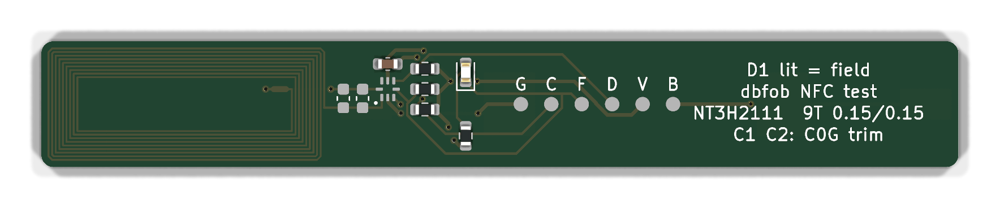

# NFC test board (for rev B / B1)

**Dropped on 2026-11-12, not ordered.** Shipped in the same order as B1 it could not steer B1's layout, and B1 answers the same question itself: its tag runs from the phone's field with no firmware, over the same antenna and cell, with its own mic and lines in place (see [B1's bench steps](../b1/README.md#on-the-bench-nfc)). Kept as a draft; it still imports [../lib/antenna.py](../lib/antenna.py) but its board files are not regenerated when that changes.

10.5 × 94 mm as drawn (B1 is now 76.5 mm; rerun make_pcb if this board is ever revived), 1.0 mm thick, 4 layers like B1 (the inner two are empty here, so the coil sees the same stack-up): B1's stick outline. It answers one question before B1 is trusted: **does B1's NFC antenna read on a phone with the AAA cell beside it, and with what trim?** This is [experiment 4](../../docs/rev-b.md#experiments-before-any-board).



It goes in the **same order as B1**, so it can't steer B1's layout. B1 copies this antenna and its trim pads exactly. Whatever trim value this board finds goes straight onto B1's pads.

## What's on it

- **Tip, 24 mm:** B1's antenna block, from [../lib/antenna.py](../lib/antenna.py), which both boards import so they can't drift apart:
  - a 9-turn PCB coil, 0.15 mm track with a 0.15 mm gap, about 23 × 9.3 mm, about 2.25 µH in air (NXP AN11276 formula);
  - its inner end meets LB through net tie NT1; LB drops through a via and crosses under the cell-end turns on B.Cu to the tag;
  - **U1** (NT3H2111, NTAG I2C plus 1k), **C3** and the **C1/C2** trim pads (not fitted) just past the coil, where they sit on B1.
- **Back:** B1's AAA cell between two MYOUNG MY-AAA-07 spring contacts, its near end about 1.4 mm past the coil. The cell is there for its steel can. At 1.5 V it can't run the tag (1.67 V minimum) or the LED.
- **Past the tag:** the pull-ups where B1 has them, the D1 field LED, and six host pads.

| Ref | What | Note |
|---|---|---|
| U1 | NT3H2111W0FHKH, C710403 | VOUT unused |
| C1, C2 | 0603 trim, **not fitted** | C0G, chosen on the bench |
| C3 | 100 nF | VCC decoupling |
| R1, R2 | 4.7 kΩ | SDA / SCL pull-ups to VCC |
| R3 | 10 kΩ | FD pull-up to VCC |
| R4, D1 | 1 kΩ, red | lit while a reader's field is on and VCC is up: FD pulls it low |
| BT1 | 2 × MY-AAA-07 (C6937109) | **hand-fit on the back**, so JLC assembly stays one-sided |
| J1 | 6 SMD pads, 2.54 mm | `G C F D V B` = GND, SCL, FD, SDA, VCC, VCELL; for wires or pogo pins |

## Regenerate

```sh
python3 hardware/lib/gen_lib.py               # NT3H2111 symbol, XQFN8 + AAA contact footprints
python3 hardware/nfc-test/tools/gen_sch.py    # tables -> schematic
python3 hardware/nfc-test/tools/make_pcb.py   # coil + placement + hand-drawn LA/LB, the router does the rest
python3 hardware/nfc-test/tools/fab.py        # -> production/
```

This follows the same procedure as rev A ([../README.md](../README.md)).

**How the antenna is drawn.** The coil is LA track; its outer end runs straight to the tag's LA pin. Its inner end meets LB through net tie NT1, and LB crosses under the turns on B.Cu (VI to VO). DRC doesn't check clearance within one net, so `antenna.py` builds the turns at a fixed pitch and asserts the 0.15 mm gap, and the vias' gap to the turns, itself.

**State at commit:**
- **ERC:** clean, apart from the library-table warnings.
- **DRC:** 0 errors, 0 unconnected, 0 parity issues.
- **Repeatability:** two runs give byte-identical boards.
- **CPL:** all 7 placements checked against JLC's EasyEDA footprints.

## On the bench

Power the tag side from a 3 V supply on V and G (or a host MCU, which also gets C, D and F) so D1 can show the field.

1. **No cell.** Tap with an Android (NXP TagInfo) and an iPhone. Write a URL with NFC Tools. Note the read distance, and the distance at which D1 lights.
2. **Find the resonance**, if a NanoVNA and a small pickup loop are at hand. Couple the loop loosely and read the S11 dip, f0. Then the trim is **C = 50 pF × ((f0 / 13.56 MHz)² − 1)**. Without a VNA, try 0, 4.7, 10, 15 and 22 pF C0G in C1, and keep the value with the longest read distance.
3. **Fit the cell** (an alkaline and, if B1 will take one, a lithium AAA). Repeat steps 1–2. This shows how much the cell costs.
4. **In the case**, if one is printed: repeat steps 1–2 with the board in it.
5. **Locked iPhone:** with the screen on, a tap should open the URL with no app.

Record f0, the trim value, the read distance and the LED distance for each step. The trim value from step 3 (or 4) goes on B1's pads.

**Why the coil is under 2.75 µH.** 13.56 MHz needs 2.75 µH with the tag's 50 pF (44–56 pF). The coil is short of that on purpose: the cell, its contacts and a phone pull the tuning about, and a parallel trim cap can only pull the resonance down.

**What it doesn't copy.** The coil, LA/LB, tag, trim pads, outline, stack-up and cell are B1's exactly. B1's Tag-Connect footprint (about 18 mm from the coil), MCU and boost converter, and its mic and lines are not: the mic's lid sits inside the coil, with two 11 mm tracks beside it, a 12 mm GND track under it, and four more nets crossing under the turns at the cell end. The cell's steel can is the bigger effect, but check B1's resonance again (VNA, step 2) before its C1/C2 value is final.

**Ordering note:** In1 and In2 are empty on purpose (same stack-up as B1). JLC may ask about blank inner layers on a 4-layer order: confirm.
